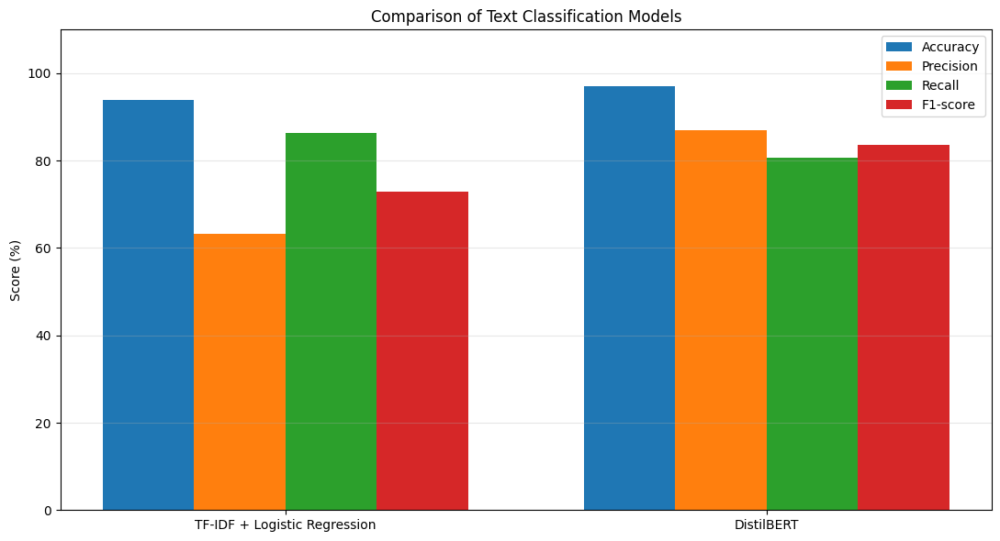
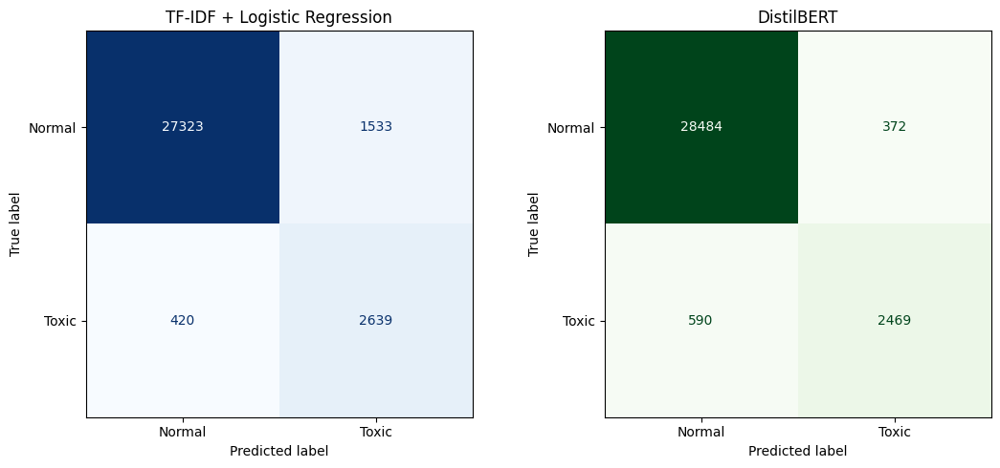

# Internet Comments Aggression Filtering

## 1. Project Description

The aim of this project is to develop a machine learning system that identifies aggressive or toxic comments on the internet.

The system uses natural language processing (NLP) techniques to classify comments into two categories:
- Normal comments
- Toxic comments

## 2. Dataset

The project uses the Jigsaw Toxic Comment Classification dataset.

- Total comments: 159,571
- Normal comments: 144,277
- Toxic comments: 15,294
- Language: English

## 3. Technologies Used

- Python
- Pandas and NumPy
- Scikit-learn
- PyTorch
- Hugging Face Transformers
- Matplotlib
- Google Colab

## 4. Machine Learning Models

Two classification models were developed and evaluated:

1. TF-IDF with Logistic Regression
2. DistilBERT

## 5. Experimental Results

| Metric | TF-IDF + Logistic Regression | DistilBERT |
|---|---:|---:|
| Accuracy | 93.88% | 96.99% |
| Precision | 63.26% | 86.97% |
| Recall | 86.27% | 80.71% |
| F1-score | 72.99% | 83.69% |

DistilBERT achieved the best overall F1-score.

## 6. Visual Results

### Model Comparison

### Confusion Matrix

## 7. Project Structure

- `code/` – source code
- `results/` – evaluation graphs and results
- `requirements.txt` – project dependencies

## 8. Limitations

The dataset contains English comments. Therefore, the current model is designed for English-language toxic comment detection and is not yet validated for Lithuanian comments.
